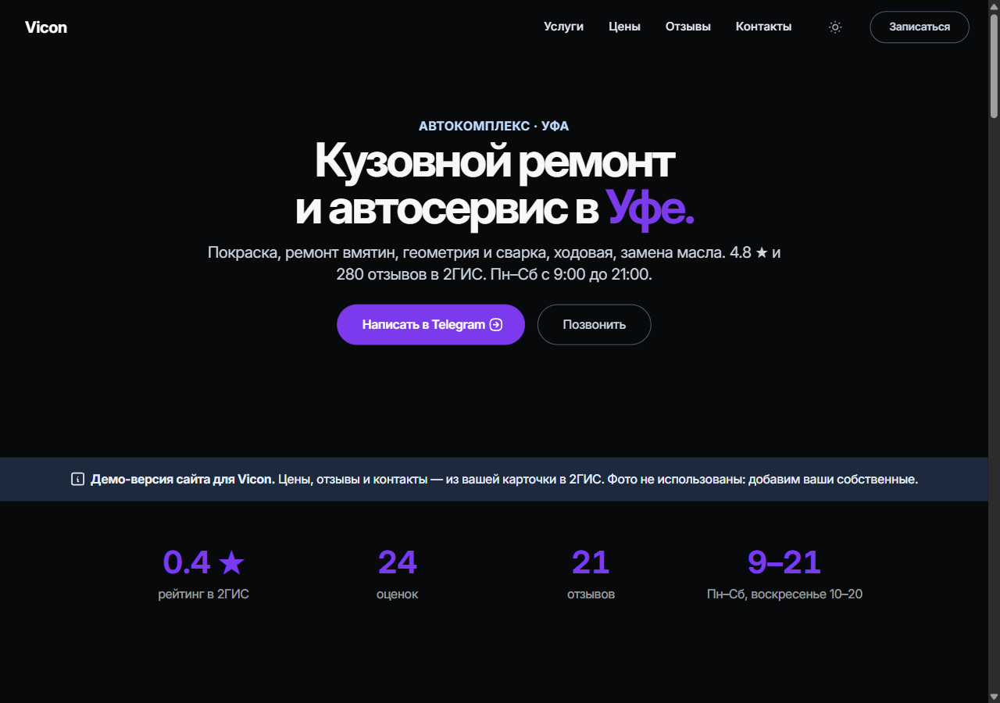

# Vicon — демо-макет сайта

Демонстрационный одностраничный сайт автосервиса Vicon в Уфе: мойка, химчистка салона, установка детских кресел, ремонт подушек безопасности. Это макет, а не коммерческий проект и не официальный сайт сервиса.

**Демо:** https://denis824-lab.github.io/demo-vicon/

## Основа

- AstroWind (MIT) — шаблон и структура секций;
- компоненты React Bits (MIT + Commons Clause) — анимации и интерактивные блоки;
- данные, цены, отзывы и фото — из публичной карточки компании в 2ГИС.

Лицензии сторонних материалов лежат в `licenses/`.

## Что адаптировано вручную

- тексты, список услуг и порядок секций под конкретный сервис;
- блок цен, рейтинг и количество отзывов;
- отзывы и контактные данные из карточки 2ГИС;
- ссылки на Telegram и телефон, первый экран и подписи кнопок.

## Стек

Готовая статика Astro: `index.html`, `_astro/`, `assets/` (включая `islands.js` и `islands.css`). Исходников Astro в репозитории нет — только собранный результат. Публикация через GitHub Pages, `.nojekyll` нужен, чтобы отдавалась папка `_astro`.

## Ограничения

- Это демо-макет, а не работа по заказу клиента.
- Формы и заявки не отправляются: серверной части нет.
- Данные, цены и отзывы не обновляются автоматически.
- На странице стоит `noindex, nofollow`, чтобы макет не конкурировал с реальным сайтом.
- Автотестов нет.

## Статус

Макет собран и опубликован. Дальнейшая доработка — по запросу.
